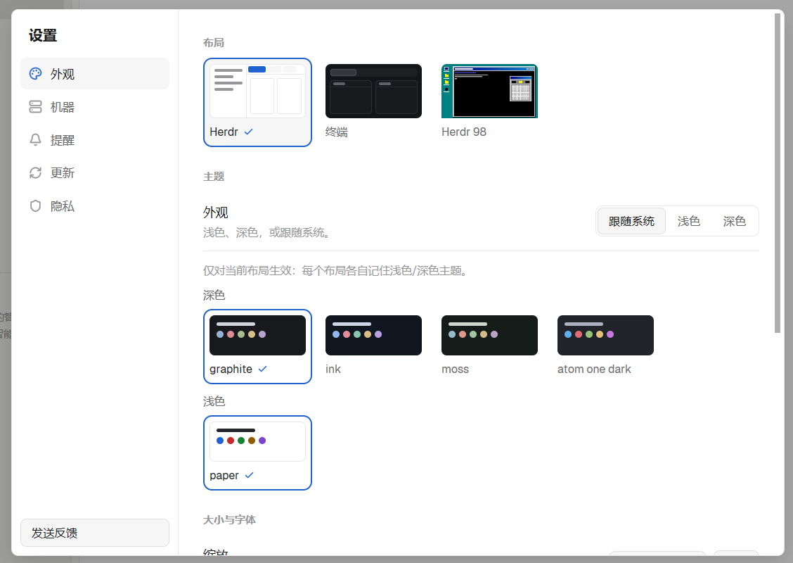

# herdr-app-zh

**非官方**的 [herdr-app](https://github.com/herdrdev/herdr-app) 简体中文界面层。
An unofficial Simplified Chinese interface layer for herdr-app.



> 非官方项目，与 Herdr 团队无关；不包含、不分发 herdr-app 的源码或二进制。
> Not affiliated with the Herdr project.

## 它做了什么

herdr-app 的界面由配置目录里的 JavaScript 模块描述（`mods/`、`frame/`）。这个项目维护一份英→中词典，只替换这些 JS 里的**字符串字面量**，再用一个极轻的守护进程在应用启动后重新应用。

- 不 fork 源码，不改 exe，不打补丁。
- 只动界面文案，不碰命令 ID、路径、代码和模板表达式。
- 设置页、命令面板、侧边栏、标签页、菜单、文件/变更/机器面板、反馈页等均已覆盖。
- 在 herdr-app **0.1.16** 上验证：32 个文件、534 处文案；除品牌/字体/按键等白名单外，残留英文 0。

## 为什么需要

herdr-app 没有 i18n 框架：英文文案被 `include_bytes!` 编进二进制，每次启动都会把 `mods/`、`frame/` 重写回英文，配置目录里的修改活不过一次重启。官方仓库里的 zh-CN 本地化仍是 open 状态（#495、#1126）。

所以这里做的是**运行期覆盖层**：应用启动 → 改写配置里的 JS → 窗口 hot reload（约 1 秒）→ 中文。守护进程每秒检查一次，只在文件真的变化时才写。

## 要求

- herdr-app 0.1.x（在 0.1.16 上验证）
- Python 3.9+
- Windows / macOS / Linux
- 可选：Node（仅 `verify_zh.py` 做 frame 语法检查时需要）

配置目录按这个顺序查找：

1. `HERDR_APP_HOME`
2. `$XDG_CONFIG_HOME/herdr-app`
3. `~/.config/herdr-app`

## 快速开始

```sh
git clone https://github.com/xinchesama/herdr-app-zh.git
cd herdr-app-zh

python src/apply_zh.py --dry-run   # 先看会改多少
python src/apply_zh.py             # 应用（窗口约 1 秒内变中文）
python src/verify_zh.py            # 校验：mods + frame
python src/audit_zh.py             # 看还剩哪些英文
```

Windows 也可以双击 `scripts\apply.cmd`。

## 开机自启

汉化需要守护进程持续重新应用；建议设为登录自启。

**Windows**

```powershell
powershell -ExecutionPolicy Bypass -File scripts\install-autostart.ps1
# 卸载：
powershell -ExecutionPolicy Bypass -File scripts\install-autostart.ps1 -Uninstall
```

**Linux（systemd user）**

```sh
# 先把 scripts/herdr-zh.service 里的路径改成你的 clone 位置
cp scripts/herdr-zh.service ~/.config/systemd/user/
systemctl --user daemon-reload
systemctl --user enable --now herdr-zh.service
```

**macOS（launchd）**

```sh
# 先把 plist 里的 REPLACE_WITH_PATH 换成你的 clone 位置
cp scripts/io.github.herdr-app-zh.plist ~/Library/LaunchAgents/
launchctl load -w ~/Library/LaunchAgents/io.github.herdr-app-zh.plist
```

也可以不开自启，需要时手动跑 `python src/zh_watch.py`。

## 常用命令

| 命令 | 作用 |
|---|---|
| `python src/apply_zh.py` | 增量汉化当前配置 |
| `python src/apply_zh.py --rebuild` | 若存在 `backup/original/` 则从英文原文重建 |
| `python src/apply_zh.py --dry-run` | 只统计，不写文件 |
| `python src/apply_zh.py --restore` | 从 `backup/original/` 恢复英文 |
| `python src/zh_watch.py` | 守护进程（前台运行） |
| `python src/verify_zh.py` | 跑 `herdr-app check` + frame 语法检查 |
| `python src/audit_zh.py --write` | 生成 `docs/coverage.md` |

## 工作方式

1. `zh_engine.py` 是一个够用的 JS 词法器：识别注释、字符串、模板、正则，**只改字符串字面量**。
2. 普通字符串整串匹配 `zh_dict.py` 的 `EXACT`；模板按 `${...}` 切段，只翻静态片段，表达式原样保留并递归处理。
3. `apply_zh.py` 写文件；`zh_watch.py` 每秒用 `(mtime, size)` 缓存扫描，发现被 Herdr 重置成就重新写。
4. `installed.json` 的指纹机制绕不过（基准来自 exe），本项目不碰它。

细节见 [docs/how-it-works.md](docs/how-it-works.md)，当前覆盖见 [docs/coverage.md](docs/coverage.md)。

## 已知限制

- 启动瞬间仍有约 1 秒英文窗口（守护扫描间隔）；无法完全消除。
- `win98` 复古演示布局未汉化；What's New 的发布说明正文保留英文。
- 品牌名（Herdr）、字体名（JetBrains Mono/Geist）、按键名（Esc/Alt/Ctrl）、Git 状态码、月份缩写保留英文。
- 这是配置层覆盖，不是源码级 i18n；Herdr 升级后可能新增英文，跑 `audit_zh.py` 补词条即可。

## Herdr 更新之后

```sh
python src/apply_zh.py --rebuild
python src/verify_zh.py
python src/audit_zh.py --write
```

`audit_zh.py` 列出的新文案，按整串加进 `src/zh_dict.py` 的 `EXACT`；带变量的加进 `TEMPLATE_WORDS`。

## 卸载

1. 取消自启（见上）。
2. 结束守护进程。
3. `python src/apply_zh.py --restore`，或直接重启 herdr-app（它会用内置英文重写）。
4. 删除本目录。

## 贡献

欢迎补词条、修翻译、适配新版本。提交前请跑：

```sh
python src/verify_zh.py
python src/audit_zh.py
```

界面文案来自 herdr-app（Apache-2.0）；新增词条请保持术语一致（空间/标签页/窗格/智能体/机器/worktree）。

## 许可

[Apache-2.0](LICENSE)。见 [NOTICE](NOTICE)。
