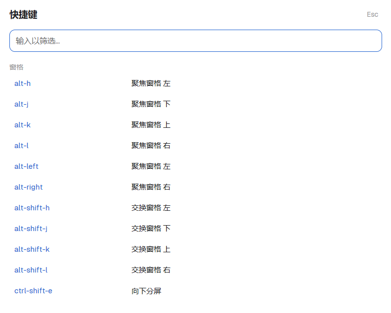
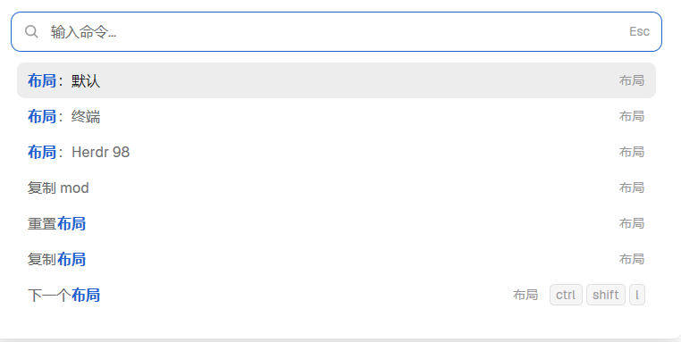

# herdr-app-zh

**非官方**的 [herdr-app](https://github.com/herdrdev/herdr-app) 简体中文界面层。
An unofficial Simplified Chinese interface layer for herdr-app.


> 非官方项目，与 Herdr 团队无关；不包含、不分发 herdr-app 的源码或二进制。
> Not affiliated with the Herdr project.

## 它做了什么

herdr-app 的界面由配置目录里的 JavaScript 模块描述（`mods/`、`frame/`）。这个项目分两层改写这些 JS：

1. **词典层**：JS 词法器只替换**字符串字面量**，模板里的 `${...}` 原样保留。
2. **代码补丁层**：字典够不到的运行时拼接文案（快捷键页的命令名、命令面板的方向词/主题/布局前缀、10 个动态命令）用精确文本补丁改代码。

- 不 fork 源码，不改 exe。
- 只动界面文案，不碰命令 ID、路径和代码逻辑（补丁除外，见下）。
- 设置页、命令面板、侧边栏、标签页、菜单、文件/变更/机器面板、反馈页等均已覆盖。
- 连应用按固定名字打开的 `peek`、`toast`、`confirm`、`prompt` 也覆盖——这是克隆布局类方案通常翻不到的部分。
- 在 herdr-app **0.1.16** 上验证：32 个文件、531 处文案 + 10 条代码补丁；除品牌/字体/按键等白名单外，残留英文 0。

| 快捷键页 | 命令面板 |
|---|---|
|  |  |

## 为什么需要

herdr-app 没有 i18n 框架：英文文案被 `include_bytes!` 编进二进制，每次启动都会把 `mods/`、`frame/` 重写回英文，配置目录里的修改活不过一次重启。官方仓库里的 zh-CN 本地化仍是 open 状态（#495、#1126）。

所以这里做的是**运行期覆盖层**：应用启动 → 改写配置里的 JS → 窗口 hot reload（约 1 秒）→ 中文。守护进程每秒检查一次，只在文件真的变化时才写。

## 要求

- herdr-app 0.1.x（在 0.1.16 上验证）
- Python 3.9+
- Windows / macOS / Linux
- 可选：Node（仅 `verify_zh.py` 做 frame 语法检查时需要）

配置目录按这个顺序查找：

1. `HERDR_APP_HOME`
2. `$XDG_CONFIG_HOME/herdr-app`
3. `~/.config/herdr-app`

## 快速开始

```sh
git clone https://github.com/xinchesama/herdr-app-zh.git
cd herdr-app-zh

python src/apply_zh.py --dry-run   # 先看会改多少
python src/apply_zh.py             # 应用（窗口约 1 秒内变中文）
python src/verify_zh.py            # 校验：mods + frame
python src/audit_zh.py             # 看还剩哪些英文
```

Windows 也可以双击 `scripts\apply.cmd`。

## 开机自启

汉化需要守护进程持续重新应用；建议设为登录自启。

**Windows**

```powershell
powershell -ExecutionPolicy Bypass -File scripts\install-autostart.ps1
# 卸载：
powershell -ExecutionPolicy Bypass -File scripts\install-autostart.ps1 -Uninstall
```

**Linux（systemd user）**

```sh
# 先把 scripts/herdr-zh.service 里的路径改成你的 clone 位置
cp scripts/herdr-zh.service ~/.config/systemd/user/
systemctl --user daemon-reload
systemctl --user enable --now herdr-zh.service
```

**macOS（launchd）**

```sh
# 先把 plist 里的 REPLACE_WITH_PATH 换成你的 clone 位置
cp scripts/io.github.herdr-app-zh.plist ~/Library/LaunchAgents/
launchctl load -w ~/Library/LaunchAgents/io.github.herdr-app-zh.plist
```

也可以不开自启，需要时手动跑 `python src/zh_watch.py`。

## 常用命令

| 命令 | 作用 |
|---|---|
| `python src/apply_zh.py` | 增量汉化当前配置 |
| `python src/apply_zh.py --rebuild` | 若存在 `backup/original/` 则从英文原文重建 |
| `python src/apply_zh.py --dry-run` | 只统计，不写文件 |
| `python src/apply_zh.py --restore` | 从 `backup/original/` 恢复英文 |
| `python src/zh_watch.py` | 守护进程（前台运行） |
| `python src/verify_zh.py` | 跑 `herdr-app check` + frame 语法检查 |
| `python src/audit_zh.py --write` | 生成 `docs/coverage.md` |

## 工作方式

1. `zh_engine.py` 是一个够用的 JS 词法器：识别注释、字符串、模板、正则，**只改字符串字面量**。
2. 普通字符串整串匹配 `zh_dict.py` 的 `EXACT`；模板按 `${...}` 切段，只翻静态片段，表达式原样保留并递归处理。
3. `zh_patches.py` 处理运行时拼接的文案：每条补丁是精确的「原文 → 中文」，锚点找不到就报错（上游改版立刻暴露）；注入的代码块包在 `/* zh:protect */` 之间，词法器会跳过，避免误翻英文键名。
4. `apply_zh.py` 写文件；`zh_watch.py` 每秒用 `(mtime, size)` 缓存扫描，发现被 Herdr 重置成就重新写。
5. `installed.json` 的指纹机制绕不过（基准来自 exe），本项目不碰它。

细节见 [docs/how-it-works.md](docs/how-it-works.md)，当前覆盖见 [docs/coverage.md](docs/coverage.md)，同类项目与四条技术路线见 [docs/alternatives.md](docs/alternatives.md)。

## 已知限制

- 启动瞬间仍有约 1 秒英文窗口（守护扫描间隔）；无法完全消除。
- 快捷键页与命令面板靠代码补丁覆盖：**Herdr 新增命令时**，新命令会先显示英文（拼出来的），补一行 `zh_patches.py` 即可。
- 补丁锚点绑定上游 0.1.16 的原文；上游改版后 `apply_zh.py` 会明确报错而不是留下半英文界面，按提示更新锚点即可。
- `win98` 复古演示布局未汉化；What's New 的发布说明正文保留英文。
- 品牌名（Herdr）、字体名（JetBrains Mono/Geist）、按键名（Esc/Alt/Ctrl）、Git 状态码、月份缩写保留英文。
- macOS 原生菜单、少数由主程序直接绘制的弹窗/错误信息改不到（配置层边界）；要覆盖这些只能改应用二进制并重签名，见 [docs/alternatives.md](docs/alternatives.md)。
- 这是配置层覆盖，不是源码级 i18n；Herdr 升级后可能新增英文，跑 `audit_zh.py` 补词条即可。

## Herdr 更新之后

```sh
python src/apply_zh.py --rebuild
python src/verify_zh.py
python src/audit_zh.py --write
```

`audit_zh.py` 列出的新文案，按整串加进 `src/zh_dict.py` 的 `EXACT`；带变量的加进 `TEMPLATE_WORDS`。

如果 `apply_zh.py` 报 `补丁失败` / `patch failed`，说明上游改了被补丁的代码：按报错里的文件名与 note 更新 `src/zh_patches.py` 的 `old` 锚点。`docs/coverage.md` 末尾的 **Code patches** 段会列出没生效的条目。

## 卸载

1. 取消自启（见上）。
2. 结束守护进程。
3. `python src/apply_zh.py --restore`，或直接重启 herdr-app（它会用内置英文重写）。
4. 删除本目录。

## 贡献

欢迎补词条、修翻译、适配新版本。提交前请跑：

```sh
python -m unittest discover -s tests -v
python src/verify_zh.py
python src/audit_zh.py
```

界面文案来自 herdr-app（Apache-2.0）；新增词条请保持术语一致（空间/标签页/窗格/智能体/机器/worktree）。

## 许可

[Apache-2.0](LICENSE)。见 [NOTICE](NOTICE)。
